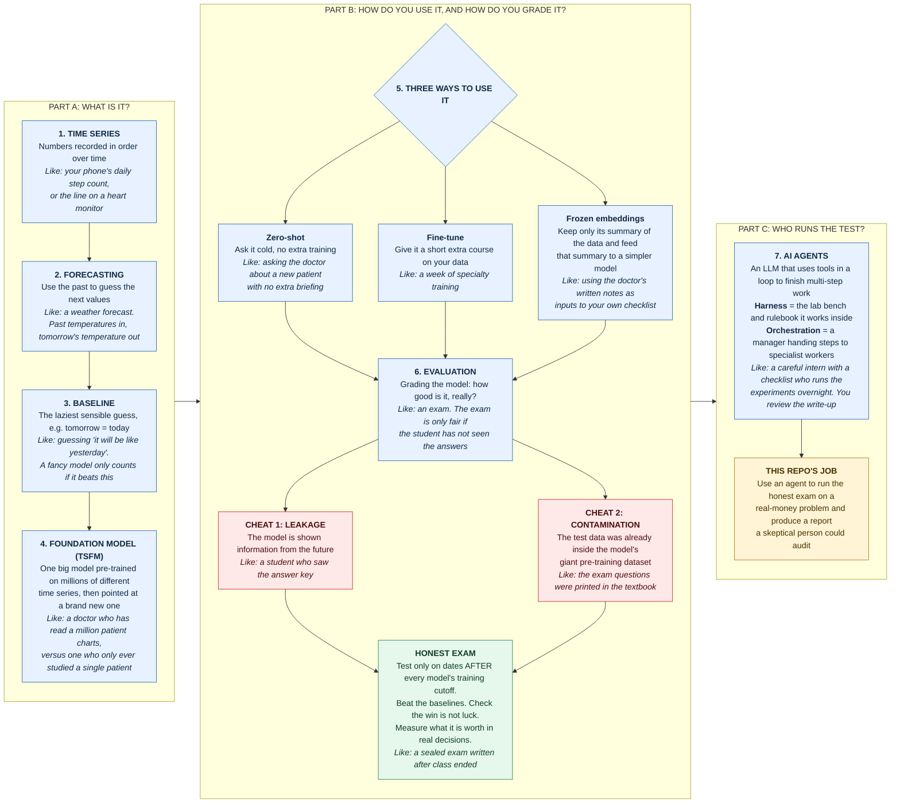
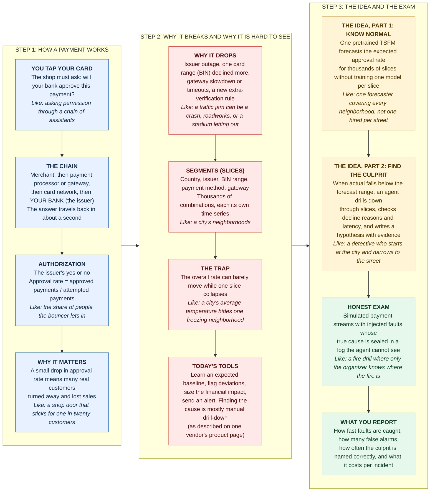
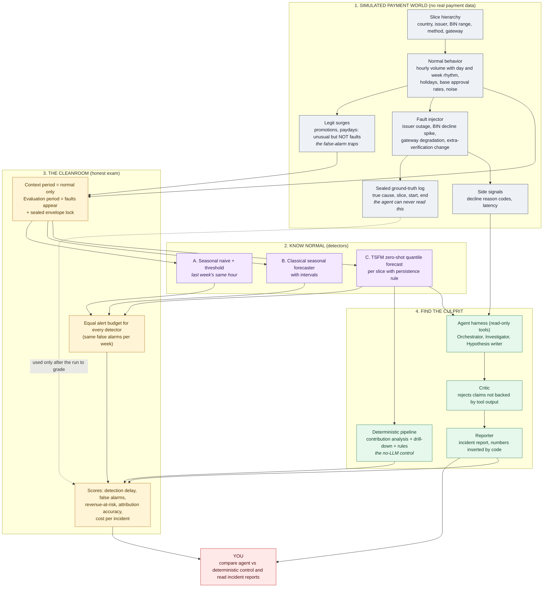

# Culprit: PLAN.md

**In one sentence:** Culprit watches payment approval rates across thousands of segments, uses a time series foundation model to know what "normal" looks like for each, and uses an AI agent to work out which bank, card range, or gateway is causing a drop, then scores itself on simulated incidents where the true cause is known.

**Why the name:** When approval rates drop, someone has to find the culprit. Most tools tell you something is wrong. This one tries to tell you who, where, and since when.

**Role in your portfolio:** Payments intelligence, the third of three fintech projects (the others are Tells for fraud and Reserve for credit risk). It is the most agent-heavy of the three, so it is where you show orchestration and harness design.

**Prerequisite:** The Cleanroom testing toolkit built in Tells (Days 1 to 11) and released as the git tag `cleanroom-v0.1`, especially the split, lock, review-budget, and bootstrap modules.

## How to use this document

| If you want to... | Read |
|---|---|
| Understand the field from zero | Part 1 (shared basics) then Part 2 |
| See how the system fits together | Part 3 |
| Explain it to a recruiter or friend | Part 4 |
| Know exactly what to build | Part 5 |
| Know what to do each day | Part 6 |
| Stay honest about limits | Part 7 |
| Check where claims come from | Part 8 |

**Diagram images:** every diagram in this file also exists as a PNG in the `diagrams/` folder next to it, with editable Mermaid source in `diagrams/source/`.

---

## Part 1. Start here: the basics, from zero

You do not need any finance or machine learning background to follow this part. Read the diagrams top to bottom. Every box has a plain definition and a real-world analogy.

### Diagram 1. The ladder of ideas (what a "time series foundation model" is, and why testing it honestly is hard)

### Diagram 2. The Cleanroom: how we keep the exam honest

The Cleanroom is the shared testing toolkit every project in this folder uses. The idea is simple: make cheating mechanically impossible, so the results are believable.

```mermaid
flowchart LR
    R["<b>Raw data</b><br/>events with timestamps<br/><i>Like: a long ledger,<br/>oldest entry first</i>"]
    S["<b>Time split</b><br/>Train on the past.<br/>Leave a gap.<br/>Test only on the future<br/><i>Like: study the textbook,<br/>then sit the exam next term</i>"]
    L["<b>Sealed envelope</b><br/>Lock the test plan and a hash of it<br/>BEFORE looking at any score<br/><i>Like: pre-registering a<br/>science experiment</i>"]
    M["<b>Contestants</b><br/>1. Lazy baseline<br/>2. Strong classic model<br/>3. TSFM zero-shot<br/>4. TSFM + classic model<br/><i>Like: a race with a<br/>walker as the control</i>"]
    P["<b>Contamination probe</b><br/>Does the model do suspiciously<br/>better on dates it may have seen?<br/><i>Like: checking if the student<br/>aced only the old questions</i>"]
    T["<b>Is it luck?</b><br/>Statistical tests + multiple-comparison correction<br/><i>Like: a coin that lands heads<br/>3 times is not magic</i>"]
    D["<b>What is it worth?</b><br/>Money-style metric for the domain<br/><i>Like: not 'how accurate',<br/>but 'how many dollars saved'</i>"]
    O["<b>Audit-ready report</b><br/>Numbers, plots, caveats,<br/>and what was NOT tested"]

    R --> S --> L --> M --> P --> T --> D --> O

    classDef step fill:#e8f1ff,stroke:#2b6cb0,color:#102a43;
    classDef lock fill:#fff4d6,stroke:#b7791f,color:#4a3200;
    classDef out fill:#e6f7ec,stroke:#2f855a,color:#0f3d24;
    class R,S,M,P,T,D step;
    class L lock;
    class O out;
```

### Glossary (plain English)

| Term | What it means | Everyday analogy |
|---|---|---|
| Time series | Measurements in time order | A diary of daily step counts |
| Forecast | A guess about future values | Tomorrow's weather |
| Horizon | How far ahead you guess (1 day, 22 days) | "Weather for tomorrow" vs "weather next month" |
| Baseline | The simplest reasonable guess you must beat | "Tomorrow will be like today" |
| Foundation model | A big model pre-trained once on huge, varied data, reused for many tasks | A doctor with a million charts of experience |
| TSFM | A foundation model for time series (examples: Chronos-2, TimesFM, Moirai, TiRex, TTM) | The same doctor, but for numbers over time |
| Zero-shot | Using a model with no extra training on your data | Asking a new patient's question cold |
| Fine-tuning | Brief extra training on your data | Specialty course |
| Embedding | A short list of numbers that summarizes something (here, an account's history) | A fingerprint or a one-line summary of a person |
| Pre-training cutoff | The last date of data a model learned from | The day the textbook was printed |
| Leakage | Future information sneaking into training or testing | Seeing the answer key |
| Contamination | Test data already inside the pre-training data | Exam questions in the textbook |
| Out-of-sample | Data the model never touched while being built | The real exam |
| Calibration | When it says "10% chance", it happens about 10% of the time | A forecaster who says 70% rain and it rains 7 days in 10 |
| Precision / recall | Of the alarms, how many were real / of the real cases, how many did we catch | A smoke alarm: false alarms vs missed fires |
| PR-AUC | One number summarizing precision vs recall when real cases are rare | A report card for a smoke alarm that rarely goes off |
| Statistical test (Diebold-Mariano) | Checks whether one forecaster's win over another is bigger than luck | Is the better free-throw shooter actually better, or just had a good night? |
| Multiple-comparison correction | If you test many ideas, some will look good by chance, so you raise the bar | Buy 100 lottery tickets and one will look like talent |
| Agent | An LLM that picks tools and acts in a loop | An intern who can run experiments |
| Harness | The tools, permissions and rules wrapped around an agent | The lab bench and safety rulebook |
| Orchestration | Coordinating several agent steps or workers | A project manager |
| Pre-registration | Writing down the test plan before seeing results | Sealing the exam rubric in an envelope |

### What the research says, in one honest paragraph

Time series foundation models are not magic for predicting stock returns. In one study, zero-shot Chronos got an out-of-sample R-squared of about -1.37 percent and TimesFM about -2.80 percent on daily returns, which means worse than simply predicting zero ([Re(Visiting) TSFMs in Finance](https://arxiv.org/html/2511.18578v1)). Another found pretrained models beat a random walk with statistical significance in only two asset-model pairs ([Pretrained TSFMs for Financial Return Forecasting](https://arxiv.org/html/2606.27100)). For realized volatility, only one model, TTM, beat the standard econometric benchmark, by roughly 1.3 to 1.8 percent ([Realized volatility with TSFMs](https://arxiv.org/html/2607.05291v1)). Meanwhile, evaluating these models fairly is itself unsolved: a lineage study of 22 TSFMs found only 6 percent of 401 datasets never appeared in any model's pre-training, and leaking just 0.1 percent of held-out data improved error by 8 to 29 points ([TSFM benchmarking challenges](https://arxiv.org/pdf/2510.13654v3)). The live, pre-registered leaderboard that would fix this (TS-Arena) covers energy only so far ([TS-Arena](https://arxiv.org/html/2512.20761v1)). So the opportunity is not "TSFMs beat the market." It is "TSFMs may be useful as feature extractors in risk problems, and almost nobody tests that honestly." That is what these projects do.

---

## Part 2. Payments, from zero

### Diagram 3. What happens when you tap a card, and where things break

**A walk-through in plain words.** Every card payment is a question: "will this bank approve it?" A business processing millions of payments watches the share that get approved. If that share dips, real customers are being declined. The cause might be a bank having trouble, a particular range of cards being treated differently, a payment gateway running slow, or a new verification step annoying customers into abandoning.

The company's dashboard may show the overall rate barely changing, because the problem lives in one small segment. There can be thousands of segments, so a human cannot look at all of them. Culprit forecasts normal behavior for every segment, flags the ones that fall outside their normal range, and has an agent investigate by narrowing from the biggest group to the smallest contributor.

**Real-world analogy for the whole project.** A city traffic control room. Waze tells you a road is slow. Culprit tries to tell you a crash on 5th Avenue started 20 minutes ago and is backing up two neighborhoods, and to say how sure it is.

---

## Part 3. How Culprit works (system diagram)

### Diagram 4. The system, including the agent

**What the agent does, and does not do.** The agent is a detective, not a judge. It receives an alert, uses read-only tools to look at slices, forecasts, decline reasons, and latency, then writes a hypothesis with the evidence it used. It never changes any system and it cannot see the sealed fault log. Afterward, code compares its answer with the log.

**An honest control.** Research on LLM forecasters found that removing the LLM often kept performance while cutting compute. So Culprit includes a deterministic, no-LLM investigation pipeline as a control. The agent has to earn its place by beating the control on attribution accuracy or by explaining better at acceptable cost. If it does not, that is the finding.

**What gap this targets (my inference, not a verified claim about any firm).** One payments-intelligence vendor page I read describes automated baselines, flagging, impact sizing, and alerting, but manual drill-down by issuer, BIN, gateway, and country, and does not claim root-cause analysis. Automated, evidence-backed attribution looks like an open area. I only read one vendor's page, so treat this as a hypothesis to test, not a market fact.

---

## Part 4. How to explain Culprit out loud

Fill the brackets only with numbers you actually measured.

### The 10-second version

"I built Culprit, which watches payment approval rates, spots when they drop, and works out which bank, card range, or gateway is the cause, then grades itself on simulated incidents where I know the real cause."

### The 30-second version (with the analogy)

"When you tap a card, your bank says yes or no, and a business cares a lot about the share of yeses. When that share drops, the cause hides in one tiny segment among thousands, like one freezing neighborhood in a warm city. I use a pretrained time series model to know what normal looks like for every segment, and an agent that narrows down from the whole city to the street causing the problem. I test it on simulated incidents where the true cause is sealed in a log the agent can't read, and I compare it to a no-AI control."

### The 2-minute version (story arc)

1. **The problem.** Approval rates drop for many reasons. The overall number hides segment-level problems, and humans cannot review thousands of segments, so root cause is slow.
2. **The idea.** A single pretrained TSFM can forecast expected behavior for thousands of segments without training a model per segment. An agent then investigates flagged segments.
3. **What I built.** (a) A payment world simulator with seasonality, legitimate surges that look like problems but are not, and injected faults with a sealed answer key. (b) Three detectors compared at an equal false-alarm budget. (c) A deterministic investigation pipeline as a control. (d) An agent with read-only tools, a critic that rejects unsupported claims, and an incident reporter.
4. **What I found.** "At [N] false alarms per week, the TSFM detector caught faults [X] hours sooner than seasonal-naive. The agent named the right culprit in [Y]% of incidents versus [Z]% for the deterministic control, at [cost] per incident." If negative: "The deterministic pipeline did just as well, so the agent's main value was the written explanation."
5. **What I'd do next.** Get anonymized real approval data under agreement, tune on real fault history, and add a human-in-the-loop approval step.

### Versions for different people

| Who | Say this |
|---|---|
| Non-technical friend | "When a store's card payments suddenly get declined more, it's hard to tell why. I built a system that figures out where the problem is, and I tested it on fake incidents where I knew the answer." |
| Recruiter | "It's an applied ML and agent systems project in payments. I built a simulator, forecasting-based detection, and an agent harness with an evaluation that compares it to a no-LLM control." |
| Hiring manager in payments | "I focus on time to detect, false-alarm budget, and attribution accuracy, which is what operations teams actually feel, and I measure cost per incident." |
| ML interviewer | "Zero-shot TSFM quantile forecasts per slice with a persistence rule, thresholds calibrated to a fixed alert budget, hierarchical contribution analysis as control, and a read-only tool-using agent with a critic, evaluated on injected faults with sealed ground truth." |

### Questions you will probably get

**What is an approval rate?** The share of attempted card payments that the customer's bank approves. A drop means more real customers get declined.

**What is a BIN?** The first digits of a card number, which identify the issuing bank and card product. Grouping by BIN range shows whether one family of cards is being treated differently.

**Why use a time series foundation model?** There are thousands of segments, each a time series. A pretrained model can forecast all of them zero-shot, which is practical where training one model per segment is not. I test whether it actually detects faster than simpler detectors at the same false-alarm rate.

**Why a simulator? Is it realistic?** Real approval data is private and not public. A simulator lets me inject faults with known causes so I can score attribution, which real data rarely allows. The trade-off is realism, so I vary simulator settings and hold out fault types, and I do not claim real-world performance.

**Why compare at the same false-alarm budget?** A detector can catch everything by alarming constantly. Operations teams suffer alert fatigue, so I compare detectors at an equal number of false alarms per week.

**What does the agent add over a plain script?** That is exactly what I test. The deterministic pipeline is the control. The agent has to beat it on attribution or provide better, evidence-backed explanations at an acceptable cost.

**How do you stop the agent from making things up?** Read-only tools, a critic that rejects any claim whose numbers are not in tool output, and incident reports whose numbers are inserted by code.

**What would you do with real data?** Run the same protocol on historical incidents with known resolutions, keep a human approving any action, and track false-alarm rate and attribution accuracy in production.

**What went wrong or surprised you?** Prepare a real answer from your logs. Good candidates: a legitimate promotion that fooled a detector, or a case where the deterministic pipeline beat the agent.

### What not to say

- Do not say it works on real payment data. It does not yet.
- Do not say it "finds root cause automatically" without adding "on simulated incidents."
- Do not say the agent fixes problems. It investigates and reports.
- Do not present vendor product claims as your own findings.

---

## Part 5. Requirements

### Problem statement

Payment operations teams monitor approval rates across many segments. Existing monitoring tools learn baselines and flag deviations, but the investigation that follows, finding which segment and cause explain a drop, is largely manual. I did not find a public, auditable evaluation of forecasting-based detection plus automated attribution with a sealed ground truth, a fixed false-alarm budget, and a no-LLM control. Culprit builds a simulator and that evaluation, and tests whether an agent adds value.

### Goals and non-goals

| Goals | Non-goals |
|---|---|
| A realistic-enough simulator with legitimate surges and injected faults | Claiming real-world performance |
| Compare detectors at an equal false-alarm budget | A production monitoring product |
| Score attribution accuracy against a sealed fault log | An agent that takes actions or changes systems |
| A deterministic no-LLM control to test whether the agent adds value | Fraud or credit modeling |
| Reuse of the Cleanroom package | A research paper (not yet) |

### Functional requirements

| ID | Requirement |
|---|---|
| FR1 | Slice hierarchy configuration (country, issuer, BIN range, payment method, gateway) with a test that child counts sum to parent counts |
| FR2 | Normal-behavior generator: hourly volume with daily and weekly seasonality, holidays, per-slice base approval rates, noise |
| FR3 | Legitimate surge generator (promotions, paydays) that shifts volume or mix without a fault |
| FR4 | Fault injector for at least four fault types: issuer outage, BIN-range decline spike, gateway degradation, extra-verification rule change |
| FR5 | Sealed ground-truth fault log written separately and readable only by the evaluator |
| FR6 | Side signals consistent with faults: decline reason codes and latency |
| FR7 | Seeded, versioned datasets with checksums |
| FR8 | Cleanroom split: normal-only context period, then an evaluation period containing faults, with the lock |
| FR9 | Three detectors: seasonal naive with threshold, classical seasonal forecaster with intervals, TSFM zero-shot quantile forecast per slice with a persistence rule |
| FR10 | Threshold calibration so every detector runs at the same false-alarm budget |
| FR11 | Metrics: detection delay, false alarms per week, revenue-at-risk before detection, attribution accuracy (top-1, top-3, fault type), cost and latency per incident |
| FR12 | Deterministic investigation pipeline: contribution analysis, hierarchical drill-down with a stopping rule, rule-based fault typing |
| FR13 | Agent harness with read-only tools (`query_slice`, `forecast`, `decline_reasons`, `latency`), a tool-call budget, and no access to the fault log |
| FR14 | Critic that rejects any claim whose cited numbers are absent from tool output |
| FR15 | Incident report template: what changed, where, since when, likely cause, confidence, evidence, what to check next. Labeled as investigation, not decision |
| FR16 | Bootstrap intervals across simulated weeks and seeds |
| FR17 | Confounder tests: a legitimate surge with no fault must not be blamed, and overlapping faults must be handled |
| FR18 | One-command reproduction of the headline table on a small simulated dataset |

### Data

- No real payment data. The simulator is the data source.
- Optional: calibrate the shape of daily and weekly seasonality from a public retail or e-commerce volume dataset. Verify license and access first.
- Vary simulator parameters across several regimes and hold out one fault type at test time, to check the system is not tuned to its own simulator.

### Evaluation protocol

1. Generate datasets from fixed seeds. Record dataset hashes.
2. Lock the config hash.
3. Run each detector on identical streams with thresholds set to the same false-alarm budget.
4. Run the deterministic pipeline and the agent on every detected incident.
5. After the run, compare outputs with the sealed fault log.
6. Report medians with bootstrap intervals across weeks and seeds, including cost per incident.
7. Report failures and fault types where nothing worked.

### Agent design

- **Orchestrator:** receives an alert, assigns work, and enforces the tool-call budget.
- **Investigator:** uses read-only tools to narrow from the whole population to the slice that explains the drop.
- **Hypothesis writer:** proposes a cause and cites the evidence.
- **Critic:** deterministic check that every cited number exists in tool output, then an LLM review of whether the evidence supports the claim.
- **Reporter:** fills the incident template, numbers inserted by code.
- **Human review:** you read the reports and the comparison with the control.
- LLM calls sit behind an interface and tests use recorded cassettes.

### Non-functional requirements

- Python 3.11 or newer, `uv`, `ruff`, `pytest`, fixed seeds, pinned versions.
- Small simulated dataset and detector run under 15 minutes on a laptop CPU.
- Every result carries config hash, git commit, model name and version, dataset hash.
- Agent runs have a hard cap on tool calls and cost per incident.

### Definition of done for v0.1

- The simulator produces legitimate surges and four fault types with a sealed log.
- Three detectors are compared at an equal false-alarm budget with intervals.
- The agent and the deterministic control are compared on attribution accuracy and cost.
- The README has Diagrams 1 to 4, a quickstart, a headline table, a demo of one incident end to end, and a limits section.
- You can give the 2-minute pitch without notes.

---

## Part 6. The 30-day plan (one shippable feature per day)

Start after the `cleanroom-v0.1` tag exists (Tells Day 11). Each day ends with a merged commit and a test.

### Days 1 to 8: the simulated payment world

| Day | Ship |
|---|---|
| 1 | Repo scaffold, install the Cleanroom from its git tag (`uv add "cleanroom @ git+https://github.com/BK5102/tells@cleanroom-v0.1#subdirectory=packages/cleanroom"`), CI, README skeleton with Diagram 1. |
| 2 | Slice hierarchy config. Test that child counts sum to parent counts. |
| 3 | Seasonality and volume generator (hour of day, day of week, holidays). Shape tests. |
| 4 | Approval process: base rates per slice plus binomial noise. |
| 5 | Legitimate surges (promotions, paydays) as false-alarm traps. |
| 6 | Fault injector with four fault types and the sealed ground-truth log. Test that the agent-facing API cannot read the log. |
| 7 | Side signals: decline reason codes and latency, consistent with faults. |
| 8 | Dataset builder with seeds, hashes, the Cleanroom split, and the lock. |

### Days 9 to 15: know normal (detectors)

| Day | Ship |
|---|---|
| 9 | Metrics: detection delay, false alarms per week, revenue-at-risk. Hand-computed tests. |
| 10 | Detector A: seasonal naive with a robust threshold. |
| 11 | Detector B: classical seasonal forecaster with prediction intervals. |
| 12 | TSFM adapter returning quantiles, batch zero-shot across many slices. |
| 13 | Detector C: TSFM interval breach with a persistence rule (k consecutive breaches). |
| 14 | Alert-budget calibration so every detector is compared at the same false-alarm rate. |
| 15 | Run all detectors over many simulated weeks and seeds, with bootstrap intervals. |

### Days 16 to 22: find the culprit without an LLM (the control)

| Day | Ship |
|---|---|
| 16 | Contribution analysis: which slice explains how much of the overall drop. Tests with known faults. |
| 17 | Hierarchical drill-down (country, issuer, BIN) with a stopping rule. |
| 18 | Rule-based fault typing from decline reasons and latency. |
| 19 | Attribution metrics: top-1, top-3, fault type accuracy. |
| 20 | Confounder tests: surge with no fault must not be blamed. |
| 21 | Overlapping faults scenario. |
| 22 | Run the control end to end and write down its numbers. This is the bar the agent must clear. |

### Days 23 to 30: the agent, the comparison, the story

| Day | Ship |
|---|---|
| 23 | Read-only tool layer: `query_slice`, `forecast`, `decline_reasons`, `latency`. No access to the fault log. |
| 24 | Orchestrator with Investigator and Hypothesis writer, a tool-call budget, and cost tracking. |
| 25 | Critic: deterministic check that cited numbers exist in tool output, then an LLM review. |
| 26 | Incident report reporter with the template, numbers inserted by code. |
| 27 | Compare agent versus control on accuracy, cost, and latency. Record LLM calls as cassettes. |
| 28 | Findings doc including negative results and sensitivity to simulator settings. |
| 29 | README polish, a demo of one incident end to end, diagrams, pitch. |
| 30 | Tag v0.1. Short build-in-public write-up (not a paper). Open three "good first issue" tickets. |

---

## Part 7. Risks and honesty rules

| Risk | What to do |
|---|---|
| Simulator realism is limited | Say so in the first screen of the README. Vary parameters, hold out a fault type, never claim real-world results. |
| Detectors accidentally tuned to the simulator's own rules | Hold out one fault type and one simulator regime at test time. |
| The agent wins only because the simulator is easy | Keep the deterministic control and report both. |
| The agent invents causes | Read-only tools, critic, numbers inserted by code, tool-call budget. |
| False alarms hide behind a loose threshold | Compare every detector at an equal false-alarm budget. |
| Agent cost is ignored | Report cost and latency per incident next to accuracy. |
| Vendor claims leak into your pitch | Quote only what you measured. Label vendor pages as "described by". |
| Scope creep into fraud or a paper | Not yet. Ship v0.1. |

---

## Part 8. Sources

- [IXOPAY anomaly detection](https://www.ixopay.com/products/payments-intelligence/anomaly-detection): vendor description of learned baselines, flagging, impact sizing, alerts, and manual drill-down. A single vendor page, not an industry survey.
- [Nexus: an agentic framework for time series forecasting](https://www.alphaxiv.org/abs/2605.14389): its own limitations note that the LLM's contribution is not isolated and cite earlier work finding that removing the LLM often kept performance at lower compute. This motivates the no-LLM control.
- [TimeCopilot](https://arxiv.org/html/2509.00616v3): open-source agentic orchestration of TSFMs, without finance-specific leakage or cost handling.
- [TSFM benchmarking challenges and leakage](https://arxiv.org/pdf/2510.13654v3): why evaluation needs strict post-training test data.
- [TS-Arena](https://arxiv.org/html/2512.20761v1): pre-registration, historization, and pseudonymization ideas behind the sealed log and lock.
- [Realized volatility with TSFMs](https://arxiv.org/html/2607.05291v1): shows that apparent TSFM wins can be calibration effects, which is why Culprit checks interval calibration and compares at an equal alert budget.
