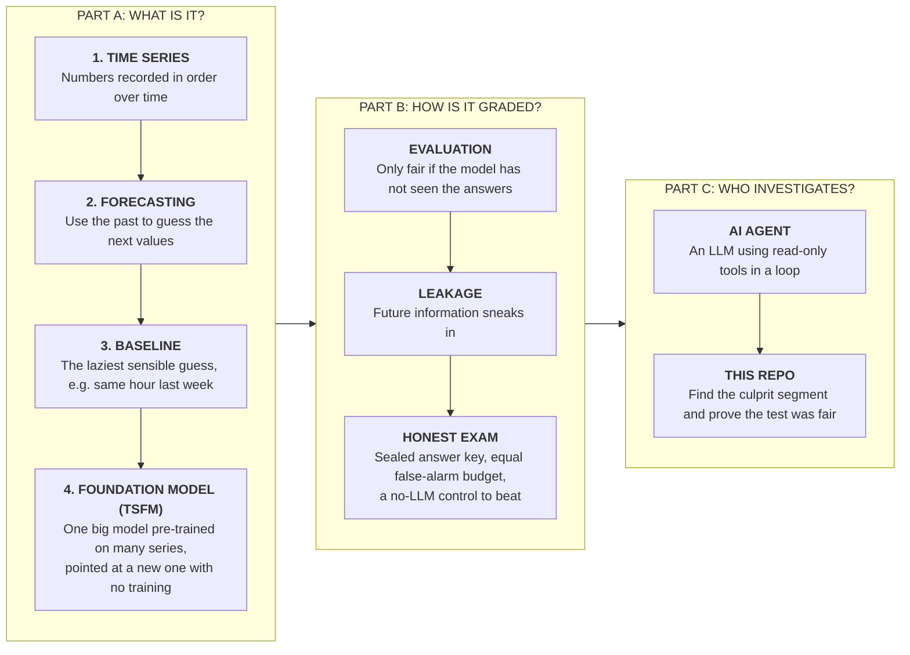

# Culprit

[](https://github.com/BK5102/culprit/actions/workflows/ci.yml)

**All data in this project is simulated.** Nothing here is real payment data, and no result here says how any method performs on a real payment system.

When you tap a card, your bank says yes or no. The share of yeses is the approval rate. When it drops, the cause usually hides in one small segment (one bank, one card range, one gateway) among thousands. Culprit learns what "normal" looks like for every segment, flags segments that fall outside it, and works out which segment and cause explain the drop. It grades itself on a simulated payment world where faults are injected and their true causes are sealed in an answer key that the detectors and the investigator cannot read.

Two questions, both scored only after the test plan is locked:

- **H1.** Does a time series foundation model (TSFM) catch drops sooner than simple detectors when every detector is allowed the same number of false alarms per week?
- **H2.** Does an LLM agent name the culprit segment more often than a deterministic, no-LLM pipeline, and at what cost per incident?

No result exists yet. See `docs/findings.md`.

## Diagram 1. The ladder of ideas



The full diagrams (1 to 4) are in `PLAN.md` and as images in `diagrams/`.

## Quickstart

Needs [uv](https://docs.astral.sh/uv/) and a laptop CPU. No GPU, no API key, and no downloads beyond Python packages.

```
uv sync
uv run pytest -q                              # 161 tests, about a minute
uv run python scripts/check_data_fit.py configs/small.yaml   # is the simulated world a fair test?
uv run culprit simulate configs/small.yaml    # build the small world (96 leaf segments, 8 weeks hourly)
uv run culprit detect configs/small.yaml      # detectors A, A2, B at 2 false alarms per week
uv run culprit attribute configs/small.yaml   # the no-LLM control names a culprit per incident
uv run culprit evaluate configs/small.yaml    # grade this development world (not a result)
```

The three middle commands take about 40 seconds together on a laptop CPU. Outputs go to `data/worlds/` and `artifacts/`, both gitignored. Every output file records the config hash, git commit and dataset hash.

Optional, for the TSFM detector (Chronos-Bolt-tiny, CPU only; the first run downloads the pinned weights from Hugging Face):

```
uv sync --extra tsfm
uv run culprit detect configs/full.yaml
```

## Manual steps for the owner

- **LLM API key and spend cap** for the agent (H2). Put `ANTHROPIC_API_KEY` in the environment (never in git) and decide a total cap and a per-incident cap. The investigator loop, critic and reporter exist and are tested with a hand-written cassette; no live call has been made.
- **The false-alarm budget.** On the first development run, 2 alarms per week counted over all series caught few faults (see `docs/explain-the-project.md`, Step 8). Decide before the lock whether to keep it, raise it, or count it per incident.
- **The sealed test.** Choose test seeds, keep `extra_verification` in the test worlds' fault types, pick a second simulator regime, set `evaluate.role: test`, then `culprit seal`, commit, `culprit run --sealed RUN_ID`, `culprit evaluate --run-id RUN_ID`.

## What is in the repo

| Part | Where |
|---|---|
| Simulator with a sealed answer key | `src/culprit/sim/` |
| Detectors and false-alarm budget calibration | `src/culprit/detect/` |
| Deterministic investigation (the no-LLM control) | `src/culprit/investigate/` |
| Agent tool layer, critic, reporter, LLM interface | `src/culprit/agent/` |
| Grading (the only reader of the answer key) | `src/culprit/evaluate/` |
| Every choice and its reasoning | `docs/methodology.md` |
| The story step by step | `docs/explain-the-project.md` |
| Measured fit of the simulated world | `docs/data-fit.md` |

## Limits

The simulator is a simplification written by the author. Its seasonality, decline reasons and fault effects are plausible assumptions, not measurements of a real network. The limitations register in `docs/methodology.md` lists each one.

## Related projects

Part of a three-project series that shares one evaluation toolkit, the Cleanroom:

- [Tells](https://github.com/BK5102/tells): does a time series foundation model help a bank-style fraud model at a fixed daily review budget? Home of the [Cleanroom](https://github.com/BK5102/tells/tree/main/packages/cleanroom).
- [Reserve](https://github.com/BK5102/reserve): do foundation models forecast mortgage delinquency curves better than classical methods?
- [Culprit](https://github.com/BK5102/culprit): do foundation models catch payment approval drops sooner, and can an LLM agent find the cause?
